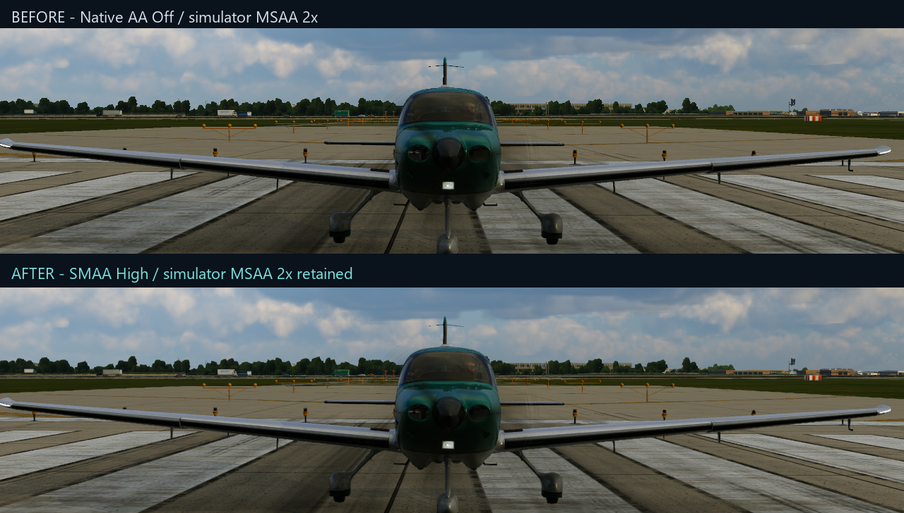

# Make XP Anti-Aliasing Great Again

Smoother edges in X-Plane 12 at your normal input resolution. Public downloads and help are here; development source is private. FSR, neural rendering and frame generation are not required.

## Downloads

| Channel | Windows | Linux |
| --- | --- | --- |
| **Betas — latest features, still being tested** | [2.0 Beta 2](https://github.com/cjboy31/make-xp-anti-aliasing-great-again/releases/tag/v2.0.0-beta.windows.2) | [2.0 Linux Beta 2](https://github.com/cjboy31/make-xp-anti-aliasing-great-again/releases/tag/v2.0.0-linux-beta.2) |
| **Release Candidates — earlier tested baseline** | [0.3.3](https://github.com/cjboy31/make-xp-anti-aliasing-great-again/releases/tag/v0.3.3-alpha) | [0.3.3 Linux beta](https://github.com/cjboy31/make-xp-anti-aliasing-great-again/releases/tag/v0.3.3-linux-beta.1) |

[Manual Windows 0.3.4 Alpha Zink hotfix](https://github.com/cjboy31/make-xp-anti-aliasing-great-again/releases/tag/v0.3.4-alpha) · [Platform limits](docs/PLATFORM-STATUS.md)

## Install and open the controls

1. Close X-Plane. Download and extract the Windows ZIP.
2. Run **NativeAA-Setup.exe**, select your X-Plane folder and click **Install / update**.
3. Start X-Plane normally and load a flight.
4. Open **Plugins > Native AA > Open AA controls**. Set X-Plane input resolution to **Full**.

Start with SMAA. Use On/Off to compare the same view. Hover over ? for help. If FSR is also installed, choose one image processor and restart. Linux users: follow [Linux installation help](docs/LINUX-BETA-INSTALLATION.txt).

Moving from before v2? Close X-Plane and back up your preferences. Use the older package's uninstaller if removing it, keep your saved settings, then install the new package into the same X-Plane folder.

**Windows Beta 2 brings current development together.** Renderer now has channel-specific update notices. The same ZIP includes native-motion image matching, multi-folder setup and the complete shader payload. Linux Beta 2 is now built and checked on Ubuntu 22.04 and 24.04; real Linux X-Plane flights remain unverified. No new flight-quality guarantee is made.

## Included in the v2 Beta

- SMAA, FXAA and CMAA 2 to smooth edges.
- Experimental TAA and combined modes to steady edges over time.
- Motion/history controls, optional sharpening and an AA memory budget.
- Saved settings, ? help, diagnostics and an in-sim changelog.

Temporal modes can leave trails or soften detail. Higher settings cost GPU time. No AA mode removes every shimmer. [Controls and starting settings](docs/CONTROLS.md)

## Before and after

Matched screenshots from the initial preview show the edge-smoothing effect. Stills do not prove moving-image quality or performance.

[View FXAA and TAA comparisons](docs/showcase/README.md)

## Help and licensing

[Join Discord](https://discord.gg/yh396QNgHZ) · [All downloads](https://github.com/cjboy31/make-xp-anti-aliasing-great-again/releases) · [Changelog](CHANGELOG.md) · [Licensing](LICENSING.md)

Choose the Windows ZIP or Linux tar.gz under Assets. GitHub's automatic “Source code” archives contain this download page, not the plugin's development source. Previously released packages keep their existing licenses. The Windows ZIPs have been repacked without development source; their renderer, plugin and compiled shaders are unchanged.