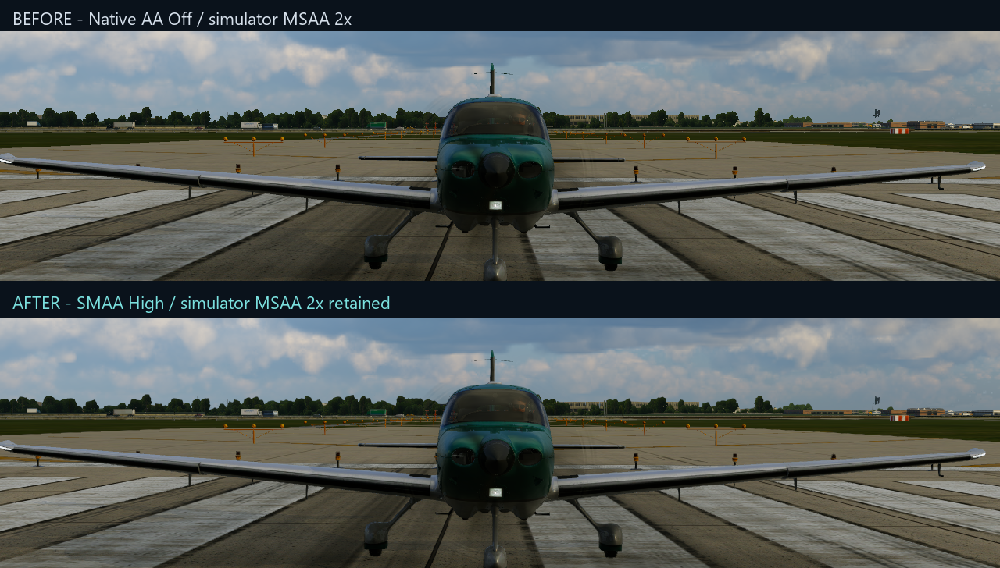
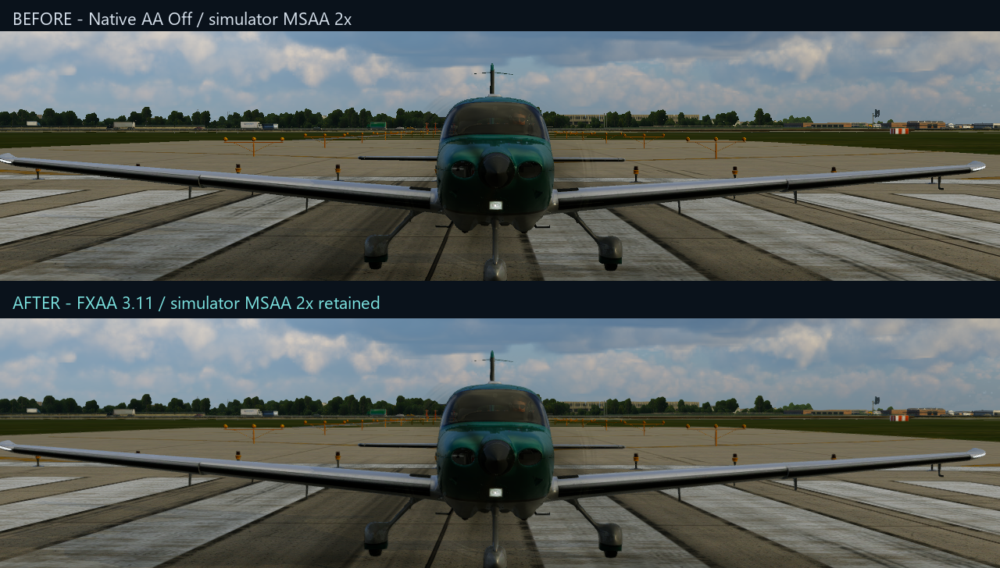
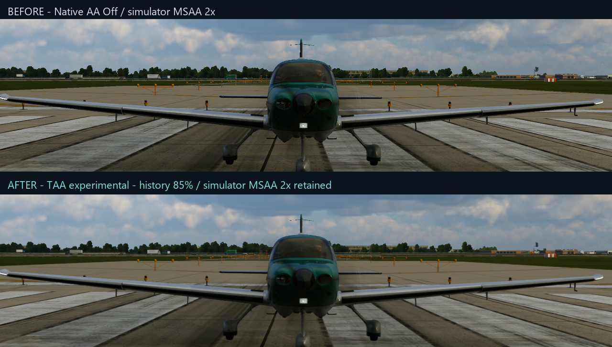

# Make XP Anti-Aliasing Great Again

Smoother edges for X-Plane 12 at your normal resolution. Change settings inside
the simulator. This mod works on its own and does not use FSR or frame generation.

## Download and install

- [Windows alpha](https://github.com/cjboy31/make-xp-anti-aliasing-great-again/releases/tag/v0.3.3-alpha): extract the ZIP, close X-Plane, and run **NativeAA-Setup.exe**. Select your X-Plane folder.
- [Linux beta](https://github.com/cjboy31/make-xp-anti-aliasing-great-again/releases/tag/v0.3.3-linux-beta.1): extract the package and run **./install.sh**. Linux flight testing is still in progress.
- Mac rendering is not available.

Launch X-Plane normally. Open **Plugins > Native AA > Open AA controls**.
Set X-Plane's input scale to **Off / Full**. You can keep MSAA enabled; start at
2x if your graphics card has room. The mod does not change your controllers.

## What it does

| Choice | What to expect |
| --- | --- |
| SMAA | Smooth jagged outlines with little softening. A good starting point. |
| FXAA | Fast smoothing that can soften fine textures and text. |
| TAA — experimental | Steadier edges over time; moving objects can leave trails. |
| TAA + SMAA / FXAA | TAA followed by extra edge smoothing. Uses more graphics time and memory. |
| Motion matching | Help TAA match detail as the camera moves. Movement is estimated. |
| Shimmer reduction | Steady slow-moving thin lines and distant detail in TAA. |

Choices save automatically and AA controls work while you fly. Use On/Off to
compare the same view. More smoothing can reduce detail. No mode removes every
flickering edge, cloud artifact or moving trail.

If you also use [FSR](https://github.com/cjboy31/xplane-fsr-vulkan), update both
mods. Choose one on the **Renderer** tab, then restart X-Plane. Both mods keep
your choices; only one processes the picture.

## See the difference

These matching Windows screenshots show edge differences. They do not show how
shimmer changes while moving. [Capture details](docs/showcase/README.md).

## Help and community

[Setup and controls](docs/CONTROLS.md) · [Linux requirements](docs/LINUX-BETA-INSTALLATION.txt)
· [Upload diagnostic logs](https://xplane-mod-log-reports.cjboy31.chatgpt.site/) · [Join Discord](https://discord.gg/yh396QNgHZ) · [Report a problem](https://github.com/cjboy31/make-xp-anti-aliasing-great-again/issues)

Version 0.3.3 corrects a Zink-related bypass and gives clearer compatibility warnings. [What changed and how to test](docs/RELEASE-0.3.3.md). The animated controls and current-session status strip are retained. Use **?** beside any setting. The package also includes a separate
optional [shadow script](extras/shadows/README.txt). The script starts Off.
Use the instructions in your download when updating older versions.

For developers: [Build](docs/BUILD-AND-VALIDATION.md) · [Validation](docs/VALIDATION.md) ·
[Motion research](docs/MOTION-SOURCES-20261031.md) · [Contributing](CONTRIBUTING.md).
Original code is MIT. [Third-party notices](THIRD_PARTY.md) are included.
