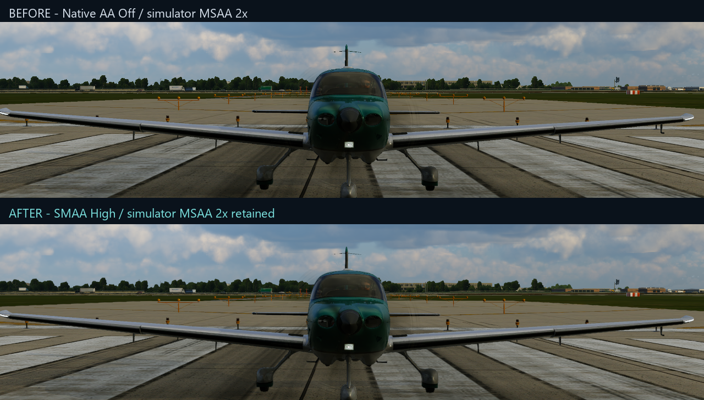
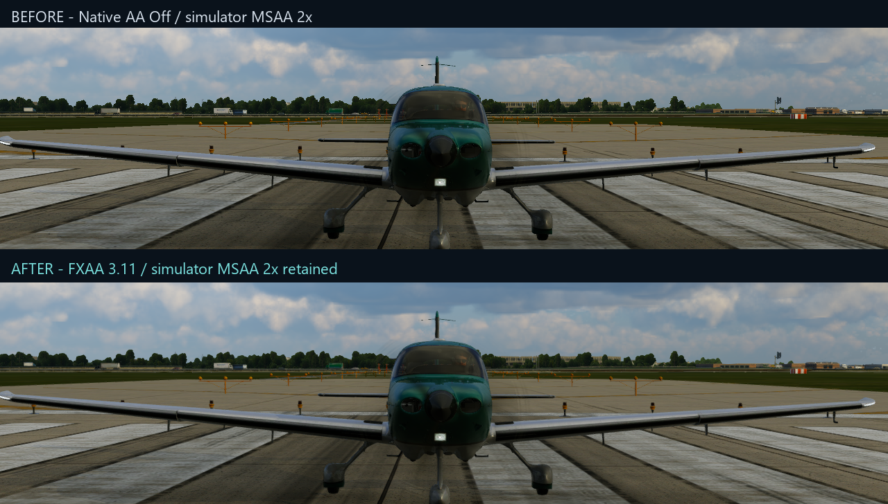
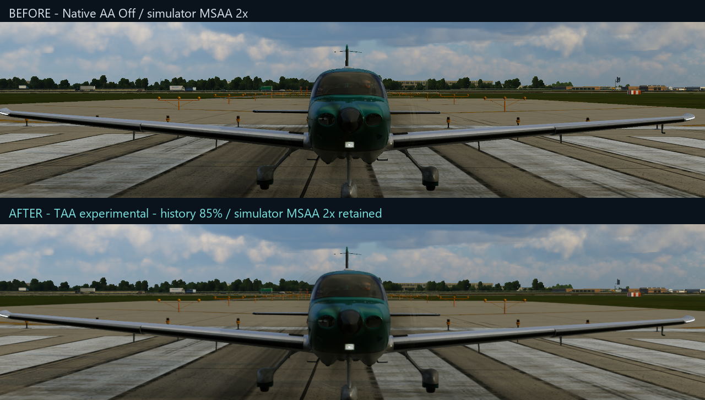

# Before and after

These real simulator screenshots show the original picture above and the AA result below. Each pair uses the same camera, scene and native 4K pixel crop. They were captured with the initial Windows AA preview; newer versions may look different.

SMAA and FXAA smooth outlines. TAA also uses earlier frames to steady edges. These still images do not measure shimmer while moving, trails or FPS. Some fine detail can become softer.

### SMAA High

### FXAA

### TAA

Screenshots are project illustrations. Depicted simulator and aircraft artwork remains the property of its respective owners.